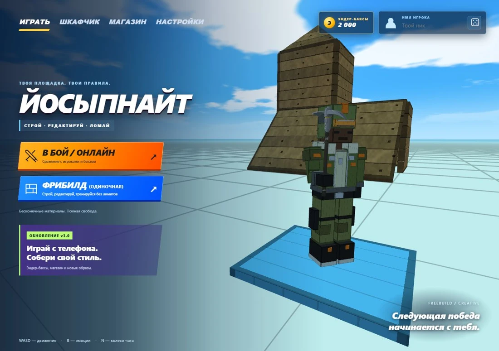

<div align="center">

# ЙОСЫПНАЙТ

**Строй. Редактируй. Побеждай.**

Браузерная игра со строительством, перестрелками и зомби-волнами.

**[▶ Играть](https://oporachka.github.io/freebuild/)** · **[Все версии и история обновлений](https://oporachka.github.io/freebuild/versions/)**

**4.1d** &nbsp; / &nbsp; ПК и телефон &nbsp; / &nbsp; Рейтинговые дуэли и кооператив



</div>

## Твоя площадка. Твои правила.

| Строй | Сражайся | Собери свой стиль |
| --- | --- | --- |
| Стены, полы, лестницы и конусы. Редактирование и три материала. | Рейтинговые дуэли до 5 побед, тренировка и зомби-волны в одиночку или вдвоём. | Скины, кирки, эмоции и голосовые фразы. Магазин за Эндер-баксы и примерка в шкафчике. |

## Начать игру

Открой игру в браузере и выбери режим. Для тренировки подойдёт **«Фрибилд (одиночная)»**.

Чтобы сыграть с другом, создай онлайн-комнату и отправь ему код. Друг открывает **ту же версию игры**, вводит код и подключается.

За рейтингом — в **«Онлайн» → «Рейтинг 1×1» → «Найти соперника»**. Старт с **1 000 ПТС**, подбор по близкому рейтингу, дуэль до **5 побед**. Оба игрока подтверждают готовность. При равном рейтинге победа даёт около **+16 ПТС**, поражение — **−16**; выход после готовности обоих считается поражением. Комнаты с друзьями ПТС не меняют.

Войди через **Google** или **почту**, чтобы использовать один баланс и шкафчик на ПК и телефоне. Подтверди почту, если регистрируешься с паролем. Можно играть гостем с локальным сохранением.

Старые покупки переносятся в аккаунт один раз через кнопку «Перенести мои покупки». Новый аккаунт получает **2 000 Эндер-баксов**; старый баланс не переносится.

## Управление

**На телефоне** — движение левым джойстиком, обзор пальцем по свободной части экрана. Джойстик до края вперёд включает бег. Оружие, постройки, редактирование и остальные действия доступны экранными кнопками. Чувствительность и сенсорный режим меняются в настройках.

<details>
<summary><strong>На ПК — раскладка клавиш</strong></summary>

| Действие | Клавиши |
| --- | --- |
| Движение, прыжок, бег | `WASD` · `Пробел` · `Shift` |
| Присесть | `Z` |
| Стрелять / строить, перезарядить | `ЛКМ` · `R` |
| Стена, пол, лестница, конус | `Q` · `F` · `C` · `V` |
| Редактировать, сбросить / удалить | `E` · `ПКМ` |
| Дверь, материал | `X` · `G` |
| Оружие и лечение | `1–5` |
| Эмоции, голосовые фразы | `B` · `N` |
| Пауза | `Esc` |

Клавиши можно переназначить: **Настройки → Бинды**.

</details>

---

<details>
<summary><strong>Для разработки</strong></summary>

Клиент не требует сборки. Основной файл — `index.html`, аккаунты и комнаты — в `server/`, архив и история — в `versions/`. Для сервера нужен Node.js 24.

[Запуск, развёртывание и границы проверки](docs/SERVER.md).

Проверки запускаются через Node.js:

```sh
npm ci --ignore-scripts
npm test
```

Границы проверки текущего релиза описаны в [SERVER.md](docs/SERVER.md#проверка-41).

</details>

<div align="center"><sub>Йосыпнайт · Раньше — Фрибилд</sub></div>
